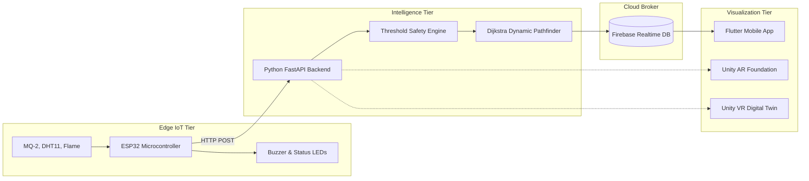

# RescueLens XR
## IoT-Based Smart Emergency Detection and Evacuation Guidance System

[](https://fastapi.tiangolo.com)
[](https://flutter.dev)
[](https://www.espressif.com)
[](https://firebase.google.com)
[](https://unity.com)
[](https://opensource.org/licenses/MIT)

---

## 1. Project Overview

**RescueLens XR** is an intelligent, multi-tiered emergency detection and evacuation guidance system designed for indoor multi-room structures. Developed as a college Computer Science Engineering mini-project, the system bridges edge IoT sensing, real-time cloud data synchronization, dynamic algorithmic pathfinding, modern cross-platform mobile UI, and Extended Reality (XR) spatial navigation.

```text
IoT Sensors ➔ ESP32 ➔ Wi-Fi ➔ FastAPI Backend ➔ Firebase RTDB ➔ Flutter Mobile App ➔ 2D/AR/VR Guidance
```

### Key Capabilities
- **Multi-Sensor Edge Detection**: Continuous sampling of Smoke PPM (MQ-2), Temperature & Humidity (DHT11), and Optical Flame (IR photodiode).
- **Dynamic Dijkstra Shortest-Path Evacuation**: Computes mathematically optimal safe evacuation paths in under 1 millisecond, automatically rerouting occupants away from compromised, fire-filled corridors.
- **Fail-Safe Trapped Mode**: If all exit routes are blocked, the system issues an immediate shelter-in-place advisory with zero dangerous false guidance.
- **Flutter Cross-Platform Mobile Client**: High-performance dark-navy UI featuring live sensor charts, 2D interactive canvas maps, and role-based access.
- **Extended Reality (XR)**:
  - **AR Wayfinding (Unity AR Foundation)**: Overlays animated 3D directional chevrons onto the corridor floor via camera passthrough.
  - **VR 3D Digital Twin (Unity 3D)**: Provides incident commanders with a 3D volumetric overview of the building with real-time fire and safe route tinting.

---

## 2. System Architecture



---

## 3. Repository Directory Structure

```text
RescueLens_XR/
│
├── backend/                    # Python FastAPI REST API & Logic Engine
│   ├── main.py                 # Application entry point & CORS configuration
│   ├── config.py               # Environment configuration & safety thresholds
│   ├── models/schemas.py       # Pydantic data schemas
│   ├── services/
│   │   ├── dijkstra.py         # Dynamic Dijkstra graph pathfinder
│   │   ├── safety_analyzer.py  # Anomaly & threshold evaluation engine
│   │   ├── simulation.py       # Simulated emergency demonstration scenarios (0-4)
│   │   └── firebase_sync.py    # Firebase Realtime Database sync bridge
│   ├── routes/                 # REST API endpoints (sensors, building, evacuation, alerts)
│   ├── test_backend.py         # Automated integration test suite (7/7 Passed)
│   └── requirements.txt        # Python package dependencies
│
├── frontend/                   # Flutter cross-platform mobile application
│   ├── lib/
│   │   ├── main.dart           # App root & authentication gateway
│   │   ├── theme/app_theme.dart# Dark navy high-contrast theme
│   │   ├── models/             # Dart data models (SensorData, RoomStatus, etc.)
│   │   ├── services/           # ApiService & AuthService
│   │   ├── providers/          # AppState reactive state manager
│   │   └── screens/
│   │       ├── auth/           # Screen 1: Login & Role Selection
│   │       ├── dashboard/      # Screen 2: Home Dashboard
│   │       ├── monitor/        # Screen 3: Real-Time Sensor Charts (fl_chart)
│   │       ├── alerts/         # Screen 4: Emergency Dispatch Center
│   │       ├── map/            # Screen 5: 2D Interactive Building Canvas Map
│   │       └── admin/          # Screen 6: Safety Commander Drill Panel
│   └── pubspec.yaml            # Flutter dependencies & assets
│
├── esp32/                      # Microcontroller edge firmware
│   ├── rescue_lens.ino         # Arduino C++ sketch for sensor reads, buzzer, LEDs
│   ├── config.h                # Pinout configuration, Wi-Fi credentials, thresholds
│   └── README.md               # Hardware wiring tables, breadboard schematics, calibration
│
├── firebase/                   # Cloud database definitions
│   ├── database_structure.json # Pre-populated database JSON for 1-click import
│   ├── database.rules.json     # Realtime Database security & validation rules
│   └── README.md               # Firebase project setup & service account guide
│
├── ar_module/                  # Unity AR Foundation spatial wayfinding
│   ├── Scripts/
│   │   ├── ARRouteNavigator.cs # 3D animated chevron path renderer & HUD billboard
│   │   └── IndoorLocalizationManager.cs # QR / visual marker door anchoring
│   └── README.md               # Unity ARCore setup & indoor positioning analysis
│
├── vr_module/                  # Unity 3D building digital twin
│   ├── Scripts/
│   │   └── VRBuildingTwin.cs   # 3D building viewer & dynamic laser ribbon pathing
│   └── README.md               # Unity 3D scene setup & incident commander guide
│
├── documentation/              # Technical reports & presentation materials
│   ├── architecture.md         # Multi-tier system specification & Dijkstra mathematics
│   ├── installation.md         # Step-by-step setup guide for each team member
│   ├── testing.md              # Test matrix, automated verification, benchmarks
│   └── user_manual.md          # 5-minute viva demonstration script & top 15 Q&As
│
├── .gitignore                  # Git ignore rules (secrets, venv, build artifacts)
├── .env.example                # Sample environment configuration template
└── README.md                   # Master project documentation
```

---

## 4. Quick-Start Guide

### 1. Launch the Backend Server
```powershell
cd c:\Users\hemam\OneDrive\Desktop\rescue\backend
.\venv\Scripts\Activate.ps1
python test_backend.py        # Runs 7 automated tests
python main.py                # Starts FastAPI server at http://localhost:8000
```
- Open Swagger Documentation: `http://localhost:8000/docs`

### 2. Launch the Flutter Mobile Application
```powershell
cd c:\Users\hemam\OneDrive\Desktop\rescue\frontend
flutter pub get
flutter run                   # Runs on connected phone or Android emulator
# Or for instant web preview:
flutter run -d chrome
```

### 3. Flash the ESP32 Firmware
1. Open [esp32/rescue_lens.ino](file:///c:/Users/hemam/OneDrive/Desktop/rescue/esp32/rescue_lens.ino) in Arduino IDE.
2. Edit [esp32/config.h](file:///c:/Users/hemam/OneDrive/Desktop/rescue/esp32/config.h) with your Wi-Fi credentials and PC's IPv4.
3. Select board `ESP32 Dev Module`, choose your COM port, and upload.

---

## 5. Three-Member Team Distribution

| Team Member | Module & Focus | Primary Deliverables |
| :--- | :--- | :--- |
| **Member 1** | **IoT Hardware & Edge Firmware** | ESP32 C++ sketch, circuit wiring, MQ-2 / DHT11 / Flame sensors, buzzer & LED actuator control, bench testing. |
| **Member 2** | **Mobile Application & UI/UX** | Flutter cross-platform app, 6 screens (Login, Dashboard, Charts, Alerts, 2D CustomPainter Map, Admin), state management. |
| **Member 3 (Lead)**| **Backend, Cloud & Algorithms** | FastAPI REST services, Dijkstra dynamic graph pathfinding, Firebase Realtime DB sync, automated test suite, documentation. |

---

## 6. Safety & Academic Disclaimer

> [!CAUTION]
> **Educational Prototype Notice**: This system is designed solely as an educational demonstration and research prototype for college coursework. The MQ-2, DHT11, and generic optical flame sensors are low-cost hobbyist sensors requiring manual calibration and are **not** certified under EN 54, NFPA 72, or UL 268 life-safety standards. Testing must be conducted using low-voltage safe stimuli (such as TV remote IR light, isopropyl alcohol vapors, or warm breath). Never introduce real open flames or hazardous smoke in laboratory environments.
