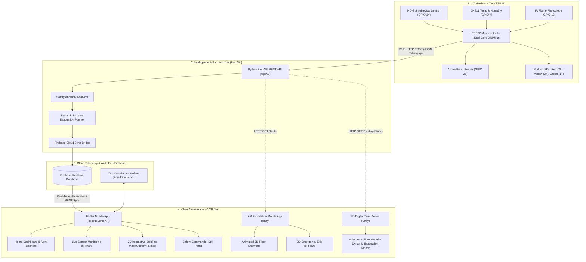

# RescueLens XR – System Architecture Specification

---

## 1. System Overview

**RescueLens XR** is a distributed, multi-tiered smart emergency detection and dynamic evacuation guidance system designed for indoor multi-room environments. The system continuously monitors atmospheric variables (smoke, combustible gases, temperature, and open flame), identifies anomalous hazards in real-time, calculates the mathematically shortest safe evacuation path around hazardous zones using **Dijkstra's Algorithm**, and visualizes safe egress routes on a **Flutter Android Mobile Application**, an **Augmented Reality (AR) HUD**, and a **Virtual Reality (VR) 3D Digital Twin**.

---

## 2. Multi-Tiered System Architecture



---

## 3. Tier-by-Tier Component Breakdown

### Tier 1: IoT Edge Microcontroller (ESP32)
- **Role**: Edge telemetry sensing, analog-to-digital conversion (ADC), local emergency sirens, and Wi-Fi transmission.
- **Microcontroller**: Espressif ESP32 dual-core Xtensa 32-bit LX6 running at 240 MHz.
- **Sensor Array**:
  - **MQ-2 Sensor**: Tin dioxide ($SnO_2$) electro-chemical sensor measuring combustible gas and smoke PPM. Connected to analog ADC pin GPIO 34.
  - **DHT11 Sensor**: Capacitive humidity sensor and thermistor providing digital temperature (0–50°C) and relative humidity (20–90%). Connected to digital GPIO 4.
  - **Optical Flame Sensor**: High-sensitivity photodiode detecting infrared wavelengths between 760 nm and 1100 nm typical of open flames. Connected to digital GPIO 18 (Active LOW).
- **Actuators**:
  - **Piezo Buzzer (GPIO 25)**: Generates acoustic alarms.
  - **Triple Status LEDs**: Green (GPIO 14 - Normal), Yellow (GPIO 27 - Caution), Red (GPIO 26 - Critical).

### Tier 2: Intelligence & Routing Engine (Python FastAPI)
- **Role**: Validates sensor streams against safety thresholds, updates zone health, calculates dynamic evacuation paths, and exposes REST endpoints.
- **Framework**: Python 3.13 + FastAPI + Uvicorn + Pydantic v2.
- **Microservices**:
  - `safety_analyzer.py`: Compares real-time readings with configured thresholds ($T_{crit} = 50^\circ\text{C}$, $Smoke_{crit} = 450\text{ PPM}$, $Flame = \text{True}$).
  - `dijkstra.py`: Graph-based shortest path algorithm that dynamically marks compromised rooms as impassable.
  - `simulation.py`: Provides deterministic emergency scenarios (Scenarios 0–4) for laboratory demonstration.

### Tier 3: Cloud Telemetry Hub (Firebase)
- **Role**: Serves as a persistent cloud data broker between edge nodes, backend services, and distributed mobile devices.
- **Firebase Realtime Database**: Low-latency NoSQL JSON store with WebSocket push synchronization.
- **Firebase Authentication**: Secures access with role-based segregation (`admin` vs `user`).

### Tier 4: Cross-Platform Mobile & Extended Reality (Flutter & Unity)
- **Flutter Android Client**: Provides occupants and safety officers with responsive 60fps dashboards, live sensor graphs, interactive 2D canvas maps, and alert feeds.
- **Unity AR Navigation**: Uses camera passthrough and AR Foundation to overlay animated 3D directional chevrons directly onto the building floor.
- **Unity VR Digital Twin**: Gives incident commanders an interactive 3D volumetric model of the building showing fire zones in glowing red and safe egress paths in glowing green.

---

## 4. Mathematical Graph Model & Dijkstra Evacuation Routing

The building floor plan is modeled as a weighted undirected graph $G = (V, E, W)$:

```text
       [ROOM_1]              [ROOM_2]              [ROOM_3]
          | (5m)                | (4m)                | (5m)
          v                     v                     v
   [CORRIDOR_WEST] <--(10m)--> [CORRIDOR_CENTRAL] <--(10m)--> [CORRIDOR_EAST]
       | (6m)                                                     | (6m)
       v                                                          v
 [EMERGENCY_EXIT]                                            [MAIN_EXIT]
```

### Mathematical Definitions
- **Vertices ($V$)**: 
  $$V = \{\text{ROOM\_1}, \text{ROOM\_2}, \text{ROOM\_3}, \text{CORRIDOR\_WEST}, \text{CORRIDOR\_CENTRAL}, \text{CORRIDOR\_EAST}, \text{MAIN\_EXIT}, \text{EMERGENCY\_EXIT}\}$$
- **Edges ($E$)**: Hallway corridors and door portals connecting adjacent nodes.
- **Weights ($W$)**: Physical walking distance in meters (e.g., $W(\text{ROOM\_1}, \text{CORRIDOR\_WEST}) = 5.0\text{ m}$).

### Dynamic Hazard Invalidation
When an emergency occurs in zone $v \in V$:
$$\text{Cost}(v) = \begin{cases} W(u, v), & \text{if } v \text{ is safe} \\ \infty, & \text{if } v \text{ is compromised by smoke or flame} \end{cases}$$

The algorithm executes using a min-heap priority queue $\mathcal{O}((|E| + |V|) \log |V|)$. If all exits are blocked ($\forall \text{exit} \in \text{Exits}, \text{Distance}(\text{origin}, \text{exit}) = \infty$), the system triggers the **TRAPPED_NO_SAFE_ROUTE** protocol.

---

## 5. Indoor Localization Limitations & Spatial Anchoring

| Criterion | Outdoor GPS | Indoor Multi-Room Environment |
| :--- | :--- | :--- |
| **Signal Availability** | Line-of-sight to 4+ satellites | Blocked / Attenuated by concrete & rebar (-30 to -50 dB loss) |
| **Accuracy** | $\pm 3\text{ to } 5\text{ meters}$ | $\pm 15\text{ to } 40\text{ meters}$ (Unusable; places user in wrong room) |
| **Multipath Distortion** | Minimal in open spaces | Extreme (RF waves bounce off interior steel framing & drywall) |
| **Altitude / Floor Level** | High vertical dilution (VDOP) | Cannot distinguish 1st floor from 3rd floor |
| **RescueLens Solution** | N/A | **Visual Fiducial Anchors (QR plaques)** + Visual-Inertial Odometry (VIO) |

RescueLens XR addresses this by mounting high-contrast visual QR markers at room doorways. When detected by the smartphone camera, `IndoorLocalizationManager.cs` snaps the virtual coordinate frame $(0, 0, 0)$ to the physical door with millimeter precision.
